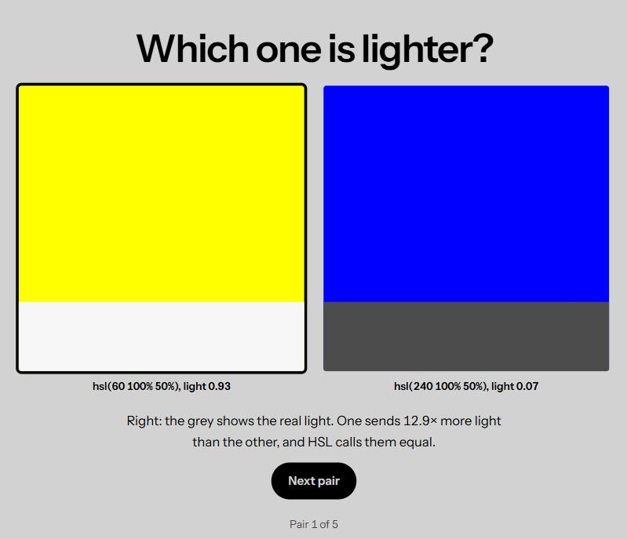
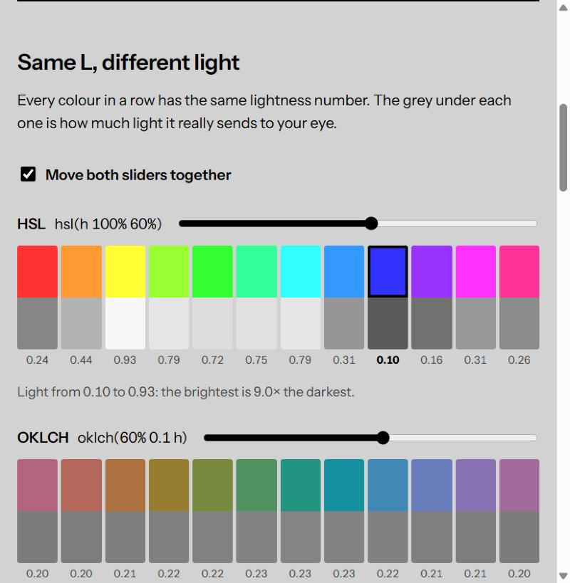

# Same lightness?

**Two colours with the same HSL lightness don't look equally light. Can you tell which one is lighter?**

### [▶ Play it: maydamv.github.io/same-lightness](https://maydamv.github.io/same-lightness/)

[](https://maydamv.github.io/same-lightness/)

Yellow and blue, both `hsl(… 100% 50%)`. CSS says they're equally light.
Your eyes say otherwise, and your eyes are right: yellow sends **12.9 times
more light** than blue.

## What's on the page

| | |
|---|---|
| **The game** | Five pairs of colours with the same HSL lightness. Pick the lighter one, then watch the grey that shows how much light each really sends. The explanation opens when you finish (or skip) the game. |
| **Same L, different light** | 12 hues at the same HSL lightness next to 12 at the same OKLCH lightness. The HSL greys go from almost white to almost black; the OKLCH greys are all the same. |
| **Under the hood** | Click any colour to see the luminance formula worked out step by step. |
| **And OKLCH?** | How OKLCH is calculated, a live check against the OKLCH row, and why designers are moving to it. |
| **Can you read it?** | A WCAG contrast checker. White text on HSL yellow: 1.07 : 1. On HSL blue: 8.59 : 1. Same lightness. |
| **Not everyone sees the same colours** | Repaints the whole page as someone with protanopia, deuteranopia, tritanopia or no colour vision would see it. |



## Why it happens

HSL's lightness is the middle point between the strongest and the weakest
RGB channel. For every fully saturated hue that's 50%, whatever the hue.

Our eyes don't work like that. We are far more sensitive to green than to
red, and much more than to blue. **Relative luminance** (the formula WCAG
uses) weights each channel by that sensitivity, after undoing the screen's
gamma curve:

```
L = 0.2126 × R + 0.7152 × G + 0.0722 × B
```

| | R | G | B | HSL lightness | Luminance |
|---|---|---|---|---|---|
| `hsl(60 100% 50%)` yellow | 1 | 1 | 0 | 50% | 0.2126 + 0.7152 = **0.93** |
| `hsl(240 100% 50%)` blue | 0 | 0 | 1 | 50% | **0.07** |

**OKLCH** is calculated differently: it undoes the gamma, turns the channels
into the response of the eye's three kinds of cone, takes a cube root (the eye
compresses light) and mixes them again into L, a and b. Its `L` is the
lightness you perceive, so the same `L` looks equally light for every hue.
That's why its row of greys is flat. For a grey it's exact: `L³` is its
luminance, so `oklch(70% …)` sits around 0.7³ = 0.34.

That predictable lightness is why teams are moving their palettes and design
tokens to OKLCH, as Evil Martians explain in
[OKLCH in CSS: why we moved from RGB and HSL](https://evilmartians.com/chronicles/oklch-in-css-why-quit-rgb-hsl).

## Run it locally

No build, no dependencies. ES modules need a server, so don't open the file
directly:

```sh
npx live-server
# or
python -m http.server
```

## The code

```
index.html     the game and the four sections
css/style.css  a neutral grey page, so it doesn't tint what you see
js/colour.js   the maths: HSL, OKLCH, luminance, contrast, colour blindness
js/main.js     the state, one draw function per section, and the events
```

Every colour goes on screen through one function, `paint()`, which is how the
colour-blindness switch can repaint the whole page.

## Sources

- HSL → RGB: [CSS Color Module Level 4](https://www.w3.org/TR/css-color-4/#hsl-to-rgb)
- Relative luminance and contrast ratio: [WCAG 2.2](https://www.w3.org/TR/WCAG22/#dfn-relative-luminance)
- OKLCH → RGB: Björn Ottosson, [A perceptual color space for image processing](https://bottosson.github.io/posts/oklab/)
- Why OKLCH in CSS: Andrey Sitnik and Travis Turner, [OKLCH in CSS: why we moved from RGB and HSL](https://evilmartians.com/chronicles/oklch-in-css-why-quit-rgb-hsl) (Evil Martians)
- Colour blindness: Machado, Oliveira & Fernandes (2009), *A Physiologically-based Model for Simulation of Color Vision Deficiency*

Made as the final project for Programming Interactivity.
